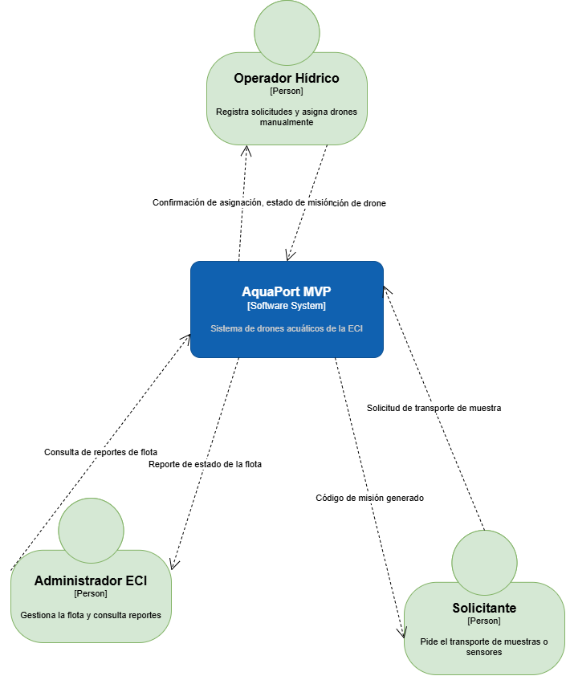
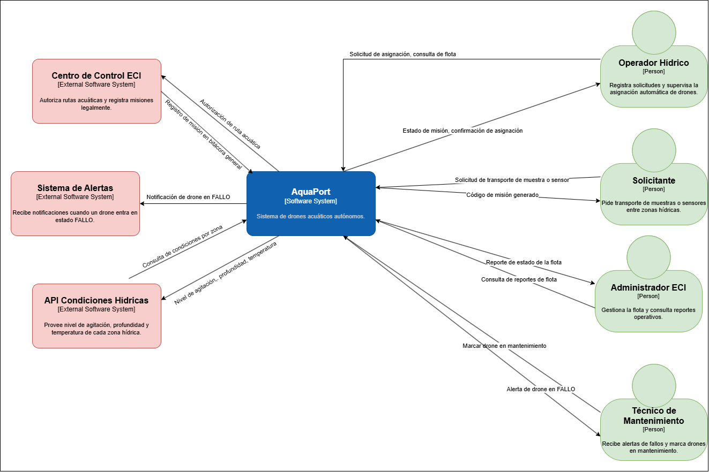

# Diagrama de Contexto C4 — Comparación Piplup vs Prinplup

Documento comparativo de los diagramas de contexto C4 del proyecto
AquaPort en los niveles Piplup (MVP) y Prinplup (v2).

---

## Piplup (MVP)

**Archivo:** [`docs/c4-contexto-piplup.png`](c4-contexto-piplup.png)

### Elementos

**Actores (3):**
- Operador Hídrico
- Solicitante
- Administrador ECI

**Sistema (1):**
- AquaPort MVP

**Sistemas externos (0):**
- Ninguno — el MVP opera sin integraciones externas.

### Flujos

| Origen | Destino | Dato |
|---|---|---|
| Operador Hídrico | AquaPort MVP | Solicitud de misión, asignación de drone |
| AquaPort MVP | Operador Hídrico | Confirmación de asignación, estado de misión |
| Solicitante | AquaPort MVP | Solicitud de transporte de muestra |
| AquaPort MVP | Solicitante | Código de misión generado |
| Administrador ECI | AquaPort MVP | Consulta de reportes de flota |
| AquaPort MVP | Administrador ECI | Reporte de estado de la flota |

---

## Prinplup (v2.0.0)

**Archivo:** [`docs/c4-contexto-prinplup.png`](c4-contexto-prinplup.png)

### Elementos

**Actores (4):**
- Operador Hídrico
- Solicitante
- Administrador ECI
- **Técnico de Mantenimiento** ← NUEVO

**Sistema (1):**
- AquaPort v2 (ahora con asignación automática, no manual)

**Sistemas externos (3):**
- **API Condiciones Hídricas** ← NUEVO
- **Centro de Control ECI** ← NUEVO
- **Sistema de Alertas** ← NUEVO

### Flujos nuevos

| Origen | Destino | Dato |
|---|---|---|
| Técnico de Mantenimiento | AquaPort v2 | Marcar drone en mantenimiento |
| AquaPort v2 | Técnico de Mantenimiento | Alerta de drone en FALLO |
| AquaPort v2 | API Condiciones Hídricas | Consulta de condiciones por zona |
| API Condiciones Hídricas | AquaPort v2 | Nivel de agitación, profundidad, temperatura |
| AquaPort v2 | Centro de Control ECI | Autorización de ruta acuática |
| Centro de Control ECI | AquaPort v2 | Registro de misión en bitácora legal |
| AquaPort v2 | Sistema de Alertas | Notificación de drone en FALLO |

---

## ¿Qué creció?

| Categoría | Piplup | Prinplup | Δ |
|---|---|---|---|
| Actores | 3 | 4 | +1 |
| Sistemas externos | 0 | 3 | +3 |
| Flujos de información | 6 | 13 | +7 |
| Complejidad del sistema | Alta cohesión, sin integraciones | Alta cohesión, con 3 integraciones | Multiplicada |

### Análisis

**Crecimiento vertical (actores):** un solo actor nuevo (Técnico de
Mantenimiento) refleja la descentralización del mantenimiento: ya no
es responsabilidad del operador hídrico.

**Crecimiento horizontal (sistemas externos):** los 3 sistemas externos
aparecen porque Prinplup introduce:
- **Asignación automática** → necesita conocer las **condiciones
  hídricas** (API).
- **Autorización de rutas** → necesita coordinar con el **Centro de
  Control ECI** (legalidad).
- **Manejo de fallos** → necesita notificar al **Sistema de Alertas**
  (monitoreo).

**Implicación arquitectónica:** a partir de Prinplup, AquaPort deja de ser
un monolito aislado. Ahora es un **orquestador** que coordina múltiples
sistemas. Esto obliga a:

1. Definir **contratos** claros con cada sistema externo (interfaces,
   formatos de datos, tolerancia a fallos).
2. **Aislar** las integraciones en la capa de infraestructura (Adapter).
3. **Manejar latencias** y reintentos: la API hídrica puede tardar; el
   Centro de Control puede no responder; el Sistema de Alertas puede
   estar caído.

## ¿Qué se mantuvo?

| Elemento | Estado en v2 |
|---|---|
| Operador Hídrico | Sigue siendo el actor principal, pero su rol cambia de "asignar manualmente" a "supervisar" |
| Solicitante | Sin cambios |
| Administrador ECI | Sin cambios |
| Flujo de solicitud → código de misión | Sin cambios |
| Flujo de reportes de flota | Sin cambios |
| Separación operador / solicitante / admin | Sin cambios |

### Análisis

Lo que se mantuvo es el **modelo de dominio**: los roles siguen siendo
los mismos, las solicitudes siguen existiendo, los reportes siguen
existiendo. Lo que cambió es **quién decide** (antes el operador, ahora
el sistema) y **con qué información** (antes solo la flota, ahora la
flota + condiciones hídricas + autorización legal).

---

## Conclusión

El paso de Piplup a Prinplup no cambia la **naturaleza** del sistema
(sigue siendo un orquestador de drones acuáticos), pero cambia
**radicalmente su alcance**:

- **Piplup:** sistema aislado, operación manual, sin dependencias.
- **Prinplup:** orquestador conectado a 3 sistemas externos,
  operación automática, con dependencias de datos en tiempo real.

La decisión arquitectónica clave de v2 es **mantener el dominio puro**
(ver auditoría SOLID del reto 04) y aislar todas las integraciones
externas en la capa de infraestructura mediante el patrón Adapter
(que aparecerá formalmente en Empoleon).