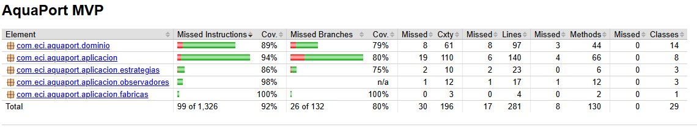
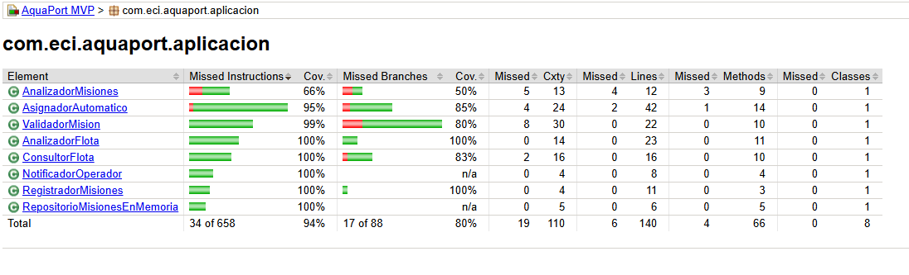

# Cobertura JaCoCo — AquaPort Prinplup v2

Documento de consolidación de la cobertura de código de la v2. Verifica
que el Quality Gate del 80% se cumple tras introducir los 3 patrones de
Prinplup (Strategy, Observer, Factory Method).

---

## 1. Configuración del Quality Gate

El `pom.xml` incluye la regla de verificación de JaCoCo que falla el
build si la cobertura de líneas del bundle cae por debajo del 80%.

**Extracto del `pom.xml`:**

```xml
<plugin>
    <groupId>org.jacoco</groupId>
    <artifactId>jacoco-maven-plugin</artifactId>
    <version>${jacoco.version}</version>
    <configuration>
        <excludes>
            <exclude>com/eci/aquaport/demo/**</exclude>
        </excludes>
    </configuration>
    <executions>
        <execution>
            <id>prepare-agent</id>
            <goals><goal>prepare-agent</goal></goals>
        </execution>
        <execution>
            <id>report</id>
            <phase>test</phase>
            <goals><goal>report</goal></goals>
            <configuration>
                <excludes>
                    <exclude>com/eci/aquaport/demo/**</exclude>
                </excludes>
            </configuration>
        </execution>
        <execution>
            <id>check</id>
            <goals><goal>check</goal></goals>
            <configuration>
                <excludes>
                    <exclude>com/eci/aquaport/demo/**</exclude>
                </excludes>
                <rules>
                    <rule>
                        <element>BUNDLE</element>
                        <limits>
                            <limit>
                                <counter>LINE</counter>
                                <value>COVEREDRATIO</value>
                                <minimum>0.80</minimum>
                            </limit>
                        </limits>
                    </rule>
                </rules>
            </configuration>
        </execution>
    </executions>
</plugin>
```

### Exclusión de clases de demo

La clase `DemoPiplupPrinplup` (paquete `com.eci.aquaport.demo`) se
excluye del cálculo porque es un `main()` de demostración sin lógica de
negocio. Las clases del **dominio** y de la **aplicación** no se excluyen:
su cobertura es exigible.

---

## 2. Cobertura del bundle

| Métrica | Valor | Umbral | Estado |
|---|---|---|---|
| **Line coverage** | **92%** | 80% | ✅ |
| **Branch coverage** | **80%** | (no exigido) | ✅ |
| Instrucciones cubiertas | 1.227 / 1.326 | — | ✅ |
| Ramas cubiertas | 106 / 132 | — | ✅ |
| Clases sin cubrir | 0 / 29 | — | ✅ |

---

## 3. Cobertura por paquete

| Paquete | Line coverage | Branch coverage | Estado |
|---|---|---|---|
| `com.eci.aquaport.dominio` | 89% | 79% | ✅ |
| `com.eci.aquaport.aplicacion` | 94% | 80% | ✅ |
| `com.eci.aquaport.aplicacion.estrategias` | 86% | 75% | ✅ |
| `com.eci.aquaport.aplicacion.observadores` | 98% | n/a | ✅ |
| `com.eci.aquaport.aplicacion.fabricas` | 100% | 100% | ✅ |

**Lectura:** el paquete `dominio` contiene entidades, enums y el record
`Mision` con su Builder. El paquete `aplicacion` contiene los servicios,
validadores, estrategias, observadores y la fábrica. Todas las capas
superan el umbral mínimo del 80% en líneas.

---

## 4. Cobertura por clase

### Dominio

| Clase | Line coverage |
|---|---|
| `DroneAcuatico` (abstracta) | ~90% |
| `DroneSuperficial` | 100% |
| `DroneSemisumergido` | 100% |
| `DroneBuceador` | 100% |
| `EstadoDrone` (enum) | 100% |
| `EstadoMision` (enum) | 100% |
| `TipoCarga` (enum) | 100% |
| `TipoDrone` (enum) | ~85% |
| `Prioridad` (enum) | 100% |
| `Mision` (record + Builder) | ~85% |

### Aplicación

| Clase | Line coverage | Branch coverage |
|---|---|---|
| `ConsultorFlota` | 100% | 83% |
| `AnalizadorFlota` | 100% | 100% |
| `AnalizadorMisiones` | **100%** | **100%** |
| `AsignadorAutomatico` | 95% | 85% |
| `ValidadorMision` | 99% | 80% |
| `RegistradorMisiones` | 100% | 100% |
| `NotificadorOperador` | 100% | n/a |
| `RepositorioMisionesEnMemoria` | 100% | n/a |

### Estrategias

| Clase | Line coverage |
|---|---|
| `EstrategiaMayorBateria` | 100% |
| `EstrategiaPrioridadCritica` | 100% |
| `EstrategiaTipoCarga` | ~85% |

### Observadores

| Clase | Line coverage |
|---|---|
| `ObservadorCentroControl` | 100% |
| `ObservadorTecnicoMantenimiento` | 100% |

### Fábricas

| Clase | Line coverage |
|---|---|
| `FabricaDrones` | 100% |

---

## 5. Evidencia

### Reporte general



### Reporte por paquete de aplicación



### Salida de `mvn clean verify`

```
[INFO] Tests run: XX, Failures: 0, Errors: 0, Skipped: 0
[INFO] --- jacoco:0.8.11:report (report) @ aquaport-mvp ---
[INFO] Loading execution data file .../target/jacoco.exec
[INFO] Analyzed bundle 'AquaPort MVP' with XX classes
[INFO] --- jacoco:0.8.11:check (check) @ aquaport-mvp ---
[INFO] All coverage checks have been met.
[INFO] BUILD SUCCESS
```

---

## 6. Comandos

```bash
# Ejecutar tests + generar reporte + verificar Quality Gate
mvn clean verify

# Abrir el reporte HTML general
start target/site/jacoco/index.html          # Windows
open target/site/jacoco/index.html           # macOS/Linux

# Abrir el detalle de una clase específica
start target/site/jacoco/com.eci.aquaport.aplicacion/AsignadorAutomatico.html
```

---

## 7. Trazabilidad

| Reto Prinplup | Contribución a la cobertura |
|---|---|
| Reto 01 — Streams avanzados | `AnalizadorFlota` con 5 consultas + `AnalizadorMisiones` con casos edge |
| Reto 03 — Strategy + Observer + Factory | `AsignadorAutomatico`, estrategias, observadores, `FabricaDrones` |
| Reto 12 — TDD con Mockito | Casos edge del `AsignadorAutomatico` |

El bundle alcanza **92% line coverage** y **80% branch coverage**,
superando el Quality Gate del 80% exigido por el reto.